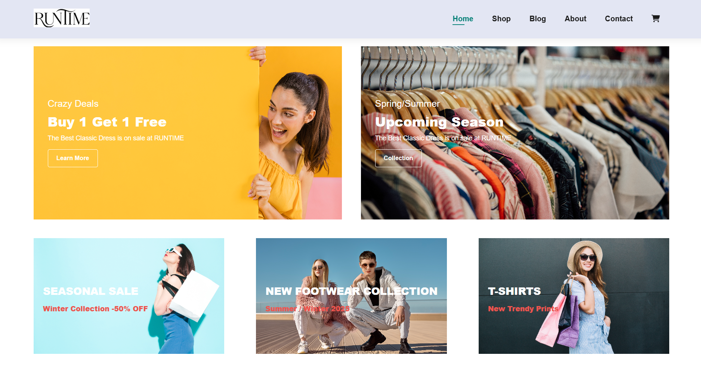
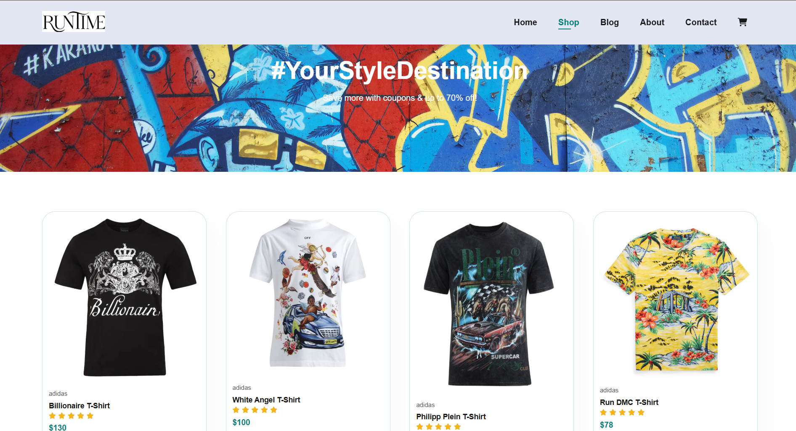
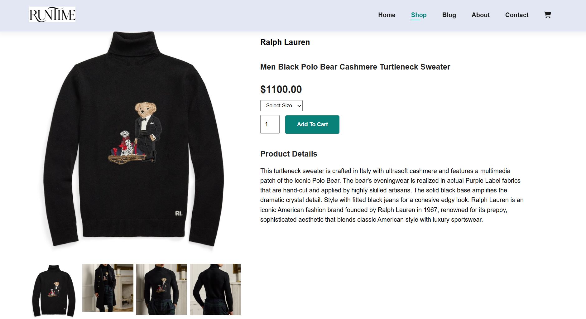
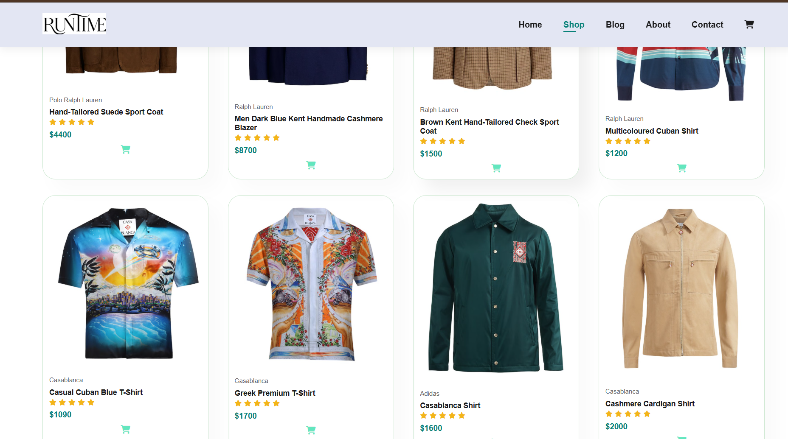
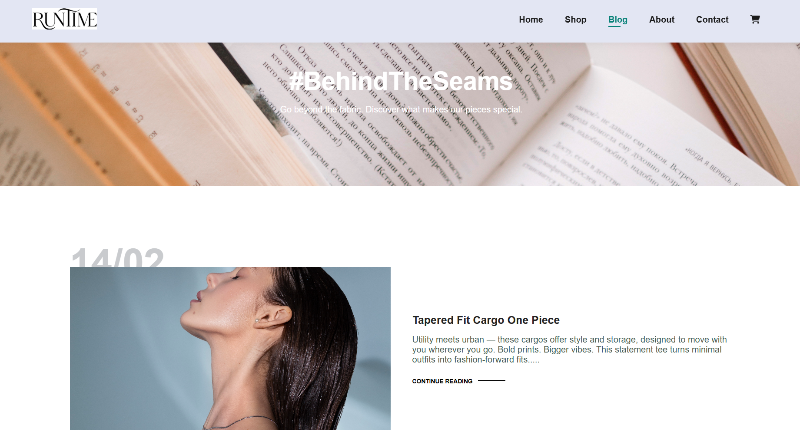
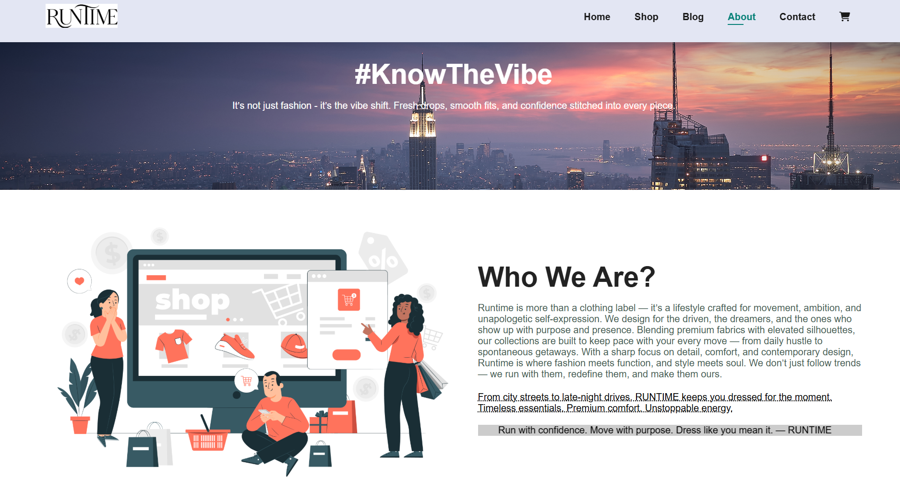
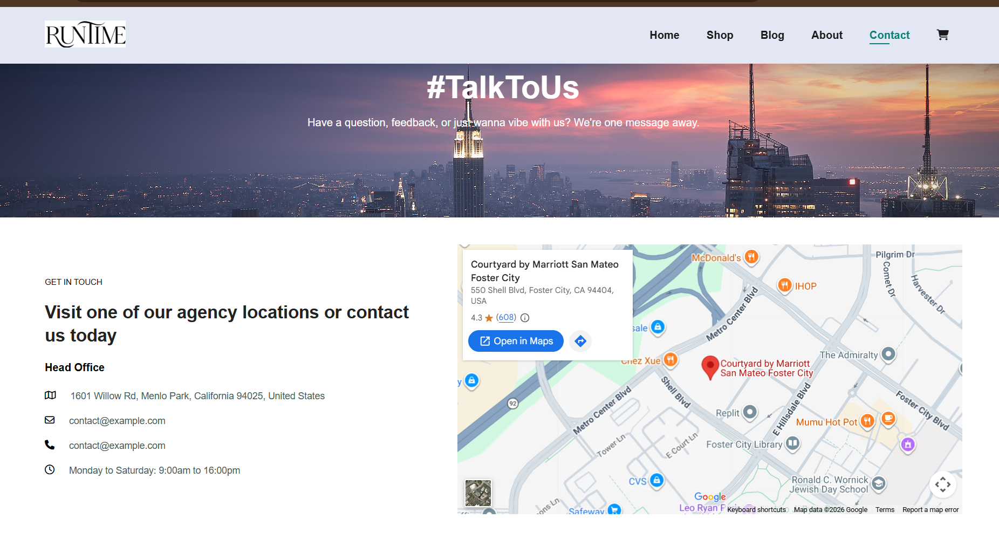
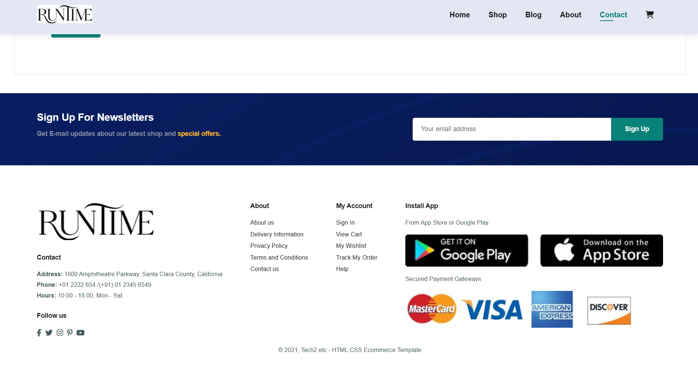

# 🛍️ Runtime — E-Commerce Website

<div align="center">

### Discover. Shop. Experience.

A modern, responsive e-commerce frontend built to deliver a smooth online shopping experience through product discovery, product details, shopping cart interactions, and a clean storefront design.

[](https://developer.mozilla.org/en-US/docs/Web/HTML)
[](https://developer.mozilla.org/en-US/docs/Web/CSS)
[](https://developer.mozilla.org/en-US/docs/Web/JavaScript)

[**View Repository**](https://github.com/manas6265517/Runtime-E-commerce)

</div>

---

## 📌 Overview

**Runtime** is a frontend e-commerce website developed to recreate the core browsing and shopping experience of a modern online store.

The project brings together product discovery, individual product pages, shopping cart interfaces, and supporting informational pages in a unified website. It focuses on creating an intuitive storefront with reusable styling, clear navigation, and an engaging visual presentation.

Built using **HTML, CSS, and JavaScript**, Runtime demonstrates foundational frontend development skills, multi-page website design, responsive styling, and client-side interaction.

## ✨ Features

### 🛍️ Product Discovery

- Browse products through a dedicated shop page.
- Explore product information through individual product detail pages.
- Navigate between the storefront and related sections.
- View product imagery and shopping-related information.

### 🛒 Shopping Cart Experience

- Dedicated cart page for the shopping workflow.
- User-friendly layout for reviewing selected items.
- Shopping interactions implemented on the frontend where supported by the application.

### 🧭 Multi-Page Navigation

The website is organized into dedicated pages:

- **Home:** Main storefront and product highlights.
- **Shop:** Product browsing experience.
- **Product Details:** Individual product information.
- **Cart:** Shopping cart interface.
- **About:** Information about the store.
- **Blog:** Content and articles.
- **Contact:** Contact information and interface.

### 🎨 Frontend Design

- Custom CSS styling.
- Product-focused layouts and imagery.
- Consistent navigation across multiple pages.
- Responsive design considerations for different screen sizes.

---

## 🖥️ Application Preview

Add screenshots of your actual website here to showcase the interface to visitors and recruiters.

> Create a `screenshots/` folder in the repository root and place your captured images inside it. Replace the filenames below with the actual image names you use.

### 01 — Home Page

The main storefront, designed to introduce the shopping experience and highlight products.



### 02 — Shop

Explore the product catalogue and browse available items.



### 03 — Product Details

A dedicated page for viewing an individual product.



### 04 — Shopping Cart

The cart interface for reviewing selected products during the shopping workflow.



### 05 — Supporting Pages

Additional pages for information, blog content, and customer contact.










---

## 🛠️ Technology Stack

| Technology | Purpose |
|---|---|
| HTML5 | Page structure and semantic content |
| CSS3 | Layout, styling, and responsive presentation |
| JavaScript | Client-side interactions |
| Git | Version control |
| GitHub | Source code hosting |

---

## 📂 Project Structure

```text
Runtime-E-commerce/
├── img/
│   └── Product images and website assets
├── index.html
├── shop.html
├── sproduct.html
├── cart.html
├── about.html
├── blog.html
├── contact.html
├── style.css
├── script.js
└── README.md
```

---

## 🚀 Getting Started

Since Runtime is a frontend project, you can run it locally without setting up a backend server, provided the website does not depend on additional external services.

### 1. Clone the Repository

```bash
git clone https://github.com/manas6265517/Runtime-E-commerce.git
cd Runtime-E-commerce
```

### 2. Open the Project

Open the project folder in Visual Studio Code.

### 3. Run the Website

Open `index.html` directly in your browser, or use the **Live Server** extension in VS Code for a convenient local development workflow.

Navigate through the website using its page links to explore the different sections.

---

## 🧠 Key Learning Outcomes

This project provided practical experience with:

- Structuring multi-page websites using HTML.
- Styling layouts and components using CSS.
- Creating product-focused user interfaces.
- Organizing assets and page resources.
- Implementing client-side interactions with JavaScript.
- Building and maintaining a frontend project with Git and GitHub.

---

## 🗺️ Potential Improvements

Future enhancements could include:

- [ ] Improved product search, sorting, and category filters.
- [ ] Enhanced cart persistence across browser sessions.
- [ ] Wishlist and saved products.
- [ ] Form validation and improved user feedback.
- [ ] Accessibility improvements and keyboard navigation.
- [ ] More comprehensive mobile and tablet testing.
- [ ] Backend integration for persistent users, products, and orders.
- [ ] Integration with a secure payment provider if the project evolves into a full-stack store.

*These are potential enhancements, not claims about existing functionality.*

---

## 👨‍💻 Author

**Manas Ranjan Haiburu**

- GitHub: [@manas6265517](https://github.com/manas6265517)
- LinkedIn: [Manas Ranjan Haiburu](https://www.linkedin.com/in/manas-ranjan-haiburu-4378332b7/)

---

<div align="center">

### Built with HTML, CSS, and JavaScript

A frontend project focused on creating a clean and accessible online shopping experience.

**If you find this project interesting, consider giving the repository a ⭐!**

[**Explore the Source Code**](https://github.com/manas6265517/Runtime-E-commerce)

</div>